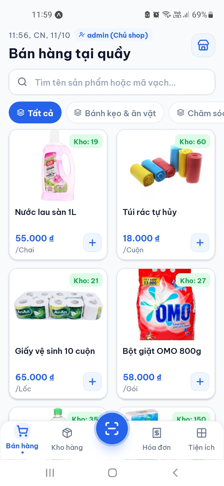
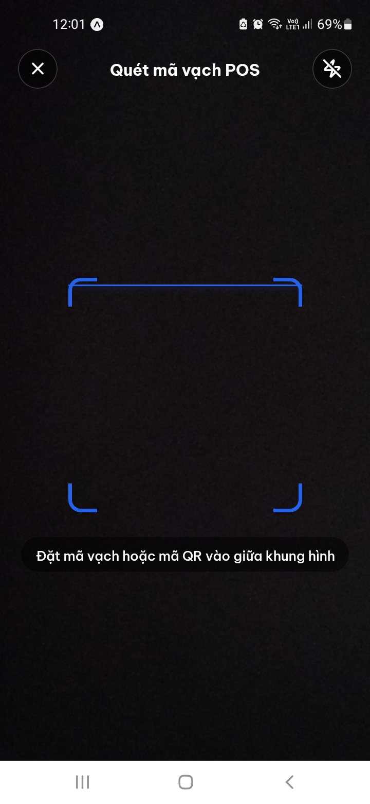
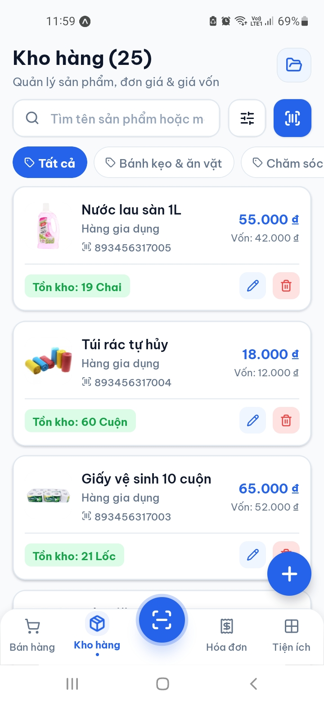
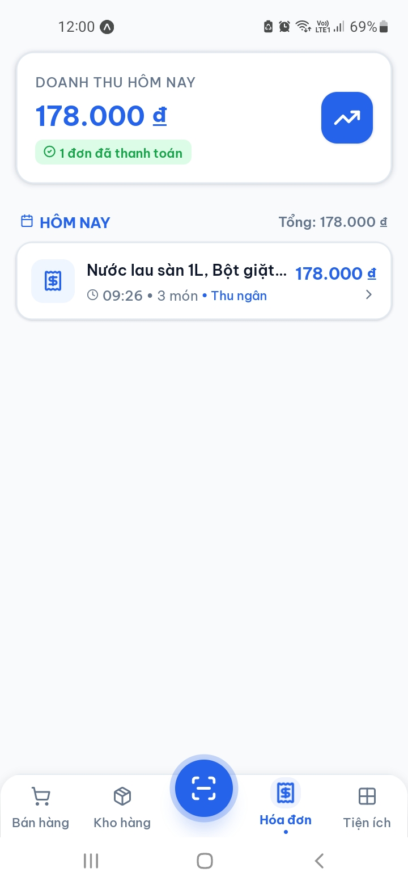
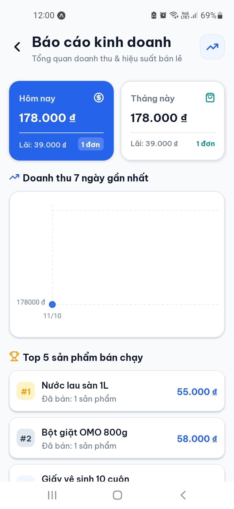

<div align="center">

  

  <h1>🛒 Grocery Store POS - Smart Retail & Cashier Mobile App</h1>
  <h3>Hệ thống Bán Hàng & Quản Lý Tạp Hóa Thông Minh Chuẩn POS Chuyên Nghiệp</h3>

  <p>
    Ứng dụng di động hiện đại hỗ trợ chủ cửa hàng tạp hóa và nhân viên thu ngân tối ưu hóa quy trình bán hàng tại quầy: 
    Quét mã vạch camera siêu tốc, đồng bộ dữ liệu thời gian thực qua WebSockets, in hóa đơn nhiệt ESC/POS không dây (Bluetooth & Wifi LAN), 
    phân quyền chặt chẽ giữa Quản lý (Admin) & Thu ngân (Cashier), cùng khả năng hoạt động mượt mà Offline-First khi mất kết nối mạng.
  </p>

  <p>
    
    
    
    
    
    
    
    
  </p>

</div>

<br />

---

## 📑 Mục lục

- [📱 Giới thiệu Ứng dụng](#-giới-thiệu-ứng-dụng)
- [🛠️ Công nghệ & Thư viện Cốt lõi](#️-công-nghệ--thư-viện-cốt-lõi)
- [🌟 Tính năng Nổi bật theo Màn hình](#-tính-năng-nổi-bật-theo-màn-hình)
  - [1. Màn hình Bán hàng tại Quầy (`PosScreen`)](#1-màn-hình-bán-hàng-tại-quầy-poscreen)
  - [2. Màn hình Quản lý Kho hàng & Tồn kho (`InventoryScreen`)](#2-màn-hình-quản-lý-kho-hàng--tồn-kho-inventoryscreen)
  - [3. Màn hình Thêm & Chỉnh sửa Sản phẩm (`AddEditProductScreen`)](#3-màn-hình-thêm--chỉnh-sửa-sản-phẩm-addeditproductscreen)
  - [4. Màn hình Quét Mã vạch Toàn cục (`GlobalScannerScreen`)](#4-màn-hình-quét-mã-vạch-toàn-cục-globalscannerscreen)
  - [5. Màn hình Lịch sử Hóa đơn Bán hàng (`InvoiceScreen`)](#5-màn-hình-lịch-sử-hóa-đơn-bán-hàng-invoicescreen)
  - [6. Màn hình Báo cáo Doanh thu & Thống kê (`AnalyticsScreen`)](#6-màn-hình-báo-cáo-doanh-thu--thống-kê-analyticsscreen)
  - [7. Màn hình Cài đặt Máy in Hóa đơn ESC/POS (`PrinterSettingsScreen`)](#7-màn-hình-cài-đặt-máy-in-hóa-đơn-escpos-printersettingsscreen)
  - [8. Màn hình Đăng nhập Vào ca (`LoginScreen`)](#8-màn-hình-đăng-nhập-vào-ca-loginscreen)
  - [9. Màn hình Cài đặt & Tiện ích (`SettingsScreen` & `MoreScreen`)](#9-màn-hình-cài-đặt--tiện-ích-settingsscreen--morescreen)
- [📸 Demo Giao diện Ứng dụng](#-demo-giao-diện-ứng-dụng)
- [🛡️ Phân quyền Vai trò Bảo mật (Admin vs Cashier)](#️-phân-quyền-vai-trò-bảo-mật-admin-vs-cashier)
- [⚡ Tối ưu Hiệu năng & Chống Tràn Bộ nhớ (OOM Crash Prevention)](#-tối-ưu-hiệu-năng--chống-tràn-bộ-nhớ-oom-crash-prevention)
- [🖨️ Động cơ In Hóa đơn Nhiệt ESC/POS (Bluetooth & Wifi LAN)](#️-động-cơ-in-hóa-đơn-nhiệt-escpos-bluetooth--wifi-lan)
- [🌐 Cơ chế Đồng bộ Realtime & Offline Cache](#-cơ-chế-đồng-bộ-realtime--offline-cache)
- [⚙️ Cấu hình Biến Môi trường (.env)](#️-cấu-hình-biến-môi-trường-env)
- [📂 Cấu trúc Thư mục Dự án](#-cấu-trúc-thư-mục-dự-án)
- [🚀 Hướng dẫn Cài đặt & Khởi chạy](#-hướng-dẫn-cài-đặt--khởi-chạy)
- [👨‍💻 Tác giả & Giấy phép](#-tác-giả--giấy-phép)

---

## 📱 Giới thiệu Ứng dụng

**Grocery Store POS** là giải pháp ứng dụng di động đa nền tảng (Android & iOS) được thiết kế đặc thù cho mô hình bán lẻ, cửa hàng tạp hóa, siêu thị mini và đại lý phân phối tại Việt Nam.

Ứng dụng giải quyết triệt để các bài toán thực tế của chủ tiệm tạp hóa:
1. **Thanh toán nhanh chóng không tắc nghẽn:** Thao tác chọn món, quét mã vạch và thanh toán diễn ra chỉ trong vài giây; gợi ý tiền mặt và tính tiền thối lại cho khách chính xác 100%.
2. **Minh bạch thu ngân & bảo mật tài chính:** Ghi nhận chính xác danh tính nhân viên lập hóa đơn (`sellerName`), che giấu hoàn toàn giá vốn nhập hàng và báo cáo lợi nhuận đối với nhân viên thu ngân thông thường.
3. **In hóa đơn nhiệt chuyên nghiệp:** Tương thích mọi dòng máy in nhiệt khổ K58 và K80 qua giao thức Bluetooth không dây hoặc mạng Wifi/LAN nội bộ, in hóa đơn sắc nét kèm tên thu ngân và thông tin cửa hàng.
4. **Trải nghiệm hiện đại & thân thiện:** Thiết kế giao diện phẳng chuẩn font **Be Vietnam Pro**, biểu tượng vector SVG Lucide nhất quán (nói không với chat emoji), hỗ trợ đầy đủ Dark Mode / Light Mode và chuyển cảnh mượt mà 60fps.

---

## 🛠️ Công nghệ & Thư viện Cốt lõi

Ứng dụng được xây dựng trên nền tảng **React Native 0.81.5** và **Expo SDK 54**:

### 🏗️ Core Mobile Stack

| Công nghệ | Phiên bản | Vai trò |
| :--- | :--- | :--- |
| **[Expo SDK](https://expo.dev/)** | `~54.0.30` | Nền tảng phát triển ứng dụng di động native, quản lý vòng đời và build tự động |
| **[React Native](https://reactnative.dev/)** | `0.81.5` | Framework phát triển ứng dụng di động đa nền tảng hiệu năng cao |
| **[React](https://react.dev/)** | `19.1.0` | Thư viện giao diện React 19 với khả năng tối ưu hóa render và Hooks mạnh mẽ |
| **[TypeScript](https://www.typescriptlang.org/)** | `~5.9.2` | Ngôn ngữ tĩnh hóa mã nguồn, bảo đảm an toàn kiểu dữ liệu 100% |
| **[React Navigation](https://reactnavigation.org/)** | `^6.6.1` | Hệ thống điều hướng phân tầng Bottom Tabs v6 và Native Stack v6 |

---

### 🎨 Design System, Typography & UI Components

| Công nghệ | Phiên bản | Vai trò |
| :--- | :--- | :--- |
| **[Be Vietnam Pro](https://fonts.google.com/specimen/Be+Vietnam+Pro)** | `^0.4.1` | Bộ font chữ chuẩn hiển thị tiếng Việt hiện đại (Regular, Medium, SemiBold, Bold, ExtraBold) |
| **[Lucide React Native](https://lucide.dev/)** | `^1.17.0` | Hệ thống biểu tượng vector SVG chuyên nghiệp, đồng bộ (thay thế hoàn toàn chat emoji) |
| **Custom Theme Engine** | `ThemeContext` | Quản lý màu sắc ngữ nghĩa (Primary Blue, Secondary Teal), hỗ trợ Light Mode & Dark Mode |
| **[Expo Image](https://docs.expo.dev/versions/latest/sdk/image/)** | `~3.0.11` | Hiển thị và lưu đệm ảnh sản phẩm siêu tốc (Memory-Disk Cache), chống tràn RAM |
| **[Safe Area Context](https://github.com/th3rdwave/react-native-safe-area-context)** | `~5.6.2` | Xử lý tràn viền Edge-to-Edge trên Android và an toàn tai thỏ / Dynamic Island trên iOS |
| **[React Native Chart Kit](https://github.com/indiespirit/react-native-chart-kit)** | `^6.12.3` | Vẽ biểu đồ doanh thu theo ngày và phân tích tài chính trực quan |

---

### 🌐 Networking, Realtime & Peripherals

| Công nghệ | Phiên bản | Vai trò |
| :--- | :--- | :--- |
| **[Axios](https://axios-http.com/)** | `^1.16.1` | Giao tiếp REST API với Backend NestJS (Interceptors tự động đính kèm JWT Bearer) |
| **[Socket.io Client](https://socket.io/)** | `^4.8.3` | Lắng nghe sự kiện WebSockets thời gian thực (`product_changed`, `category_changed`, `invoice_created`) |
| **[Expo Camera](https://docs.expo.dev/versions/latest/sdk/camera/)** | `~17.0.10` | Quét mã vạch Barcode (EAN-13, Code 128) và mã QR siêu tốc |
| **[Expo Image Picker](https://docs.expo.dev/versions/latest/sdk/imagepicker/)** | `~17.0.11` | Chụp ảnh sản phẩm từ camera hoặc chọn từ album máy để upload lên Cloudinary |
| **AsyncStorage** | `^2.2.0` | Lưu trữ cục bộ JWT token, thông tin phiên thu ngân và cấu hình máy in |
| **NetInfo** | `11.4.1` | Giám sát trạng thái kết nối mạng thời gian thực để cảnh báo mất mạng |

---

## 🌟 Tính năng Nổi bật theo Màn hình

### 1. Màn hình Bán hàng tại Quầy (`PosScreen`)
* **Lưới Sản phẩm 2 Cột Tối ưu Hóa:** 
  - Render ảnh downsampling với `expo-image` kết hợp danh sách ảo hóa `FlatList` (`windowSize={3}`, `initialNumToRender={6}`), loại bỏ hoàn toàn hiện tượng văng ứng dụng khi danh mục chứa hàng trăm sản phẩm.
  - Phù hiệu huy hiệu chào ca làm việc thông minh (`Xin chào, Admin!` / `Xin chào, Thu ngân!` kèm icon `UserCheck`).
* **Băng Chuyền Danh mục (Category Ribbon):** Bộ lọc ngành hàng vuốt ngang mượt mà, phân loại tức thì sản phẩm theo từng nhóm hàng hóa.
* **Thanh Giỏ Hàng Nổi (Floating Cart Bar):**
  - Hiển thị tổng số lượng món và tổng tiền với hiệu ứng rung nảy Micro-interaction (`Animated.spring`).
  - Được tính toán tọa độ chân trang cao ráo (`bottom: 104px + insets.bottom`), không bị che khuất bởi nút quét mã tròn ở Bottom Tab Bar.
* **Modal Chi Tiết Đơn Hàng Trung Tâm (Center Cart Modal):**
  - Hiển thị ở giữa màn hình thay vì trượt từ đáy, cách đáy màn hình >130px đảm bảo không chạm nút quét QR.
  - Tăng / giảm số lượng món siêu tốc; hỗ trợ xóa từng món hoặc xóa toàn bộ giỏ hàng.
  - **Phân quyền sửa giá tại quầy:** Chỉ Quản lý (Admin) mới có quyền bấm icon bút chì để đổi giá bán đơn lẻ; Thu ngân (Cashier) hiển thị icon khóa `Lock` mờ và không thể can thiệp.
  - **Gợi ý tiền mặt thông minh:** Các chip chọn nhanh tiền khách đưa (Đủ tiền, 50k, 100k, 200k, 500k...) và tính toán tự động số tiền thối lại khách.
  - **Thanh toán & In hóa đơn 1 chạm:** Tự động gọi máy in nhiệt xuất hóa đơn và phát tín hiệu Socket.io cập nhật trừ tồn kho ngay lập tức.

---

### 2. Màn hình Quản lý Kho hàng & Tồn kho (`InventoryScreen`)
* **Giám sát Tồn kho Toàn diện:** Danh sách mặt hàng kèm trạng thái tồn kho trực quan (Còn hàng, Sắp hết hàng `< 5`, Hết hàng).
* **Tìm kiếm & Phân trang Thông minh:** Tìm kiếm nhanh theo tên sản phẩm hoặc mã vạch SKU với cơ chế Debounce 350ms tiết kiệm tài nguyên.
* **Bảo Mật Giá Vốn Nhập:** Chỉ tài khoản **Admin** mới nhìn thấy thông tin giá vốn nhập hàng (`costPrice`); nhân viên **Thu ngân** bị ẩn hoàn toàn trường dữ liệu này nhằm bảo vệ thông tin tài chính nhạy cảm của cửa hàng.
* **Khóa Chức năng Xóa:** Nút xóa sản phẩm chỉ khả dụng đối với Quản lý; hạn chế tối đa rủi ro thất thoát dữ liệu do nhân viên thao tác nhầm.

---

### 3. Màn hình Thêm & Chỉnh sửa Sản phẩm (`AddEditProductScreen`)
* **Chụp & Tải Ảnh Đám Mây Cloudinary:** Chụp ảnh bao bì sản phẩm trực tiếp từ camera hoặc tải ảnh từ thư viện, sử dụng chữ ký số bảo mật từ Backend để upload trực tiếp lên CDN.
* **Chuẩn hóa Giao diện Nhập liệu:** Đồng bộ 100% kích thước ô nhập (chiều cao chuẩn 48px), màu chữ `colors.text` và màu placeholder `colors.mutedText` dịu mắt theo chuẩn ô Tên sản phẩm.
* **Danh mục Toàn màn hình:** Dropdown chọn ngành hàng hiển thị trọn vẹn 100% chiều rộng, hỗ trợ chế độ `mode="dropdown"` không bị che khuất nội dung.
* **Tích hợp Nút Quét Mã vạch SKU:** Bấm nút `[Quét mã]` để bật camera quét chuỗi mã vạch in trên bao bì sản phẩm và tự động điền vào ô SKU.

---

### 4. Màn hình Quét Mã vạch Toàn cục (`GlobalScannerScreen`)
* **Động cơ Camera Siêu tốc:** Quét tự động đa chuẩn mã vạch (EAN-13, EAN-8, Code 128, Code 39, QR Code).
* **Đa chế độ Hoạt động (Multi-action):**
  - **Chế độ Bán hàng (`addToCart`):** Quét mã sản phẩm tại quầy thu ngân -> Tự động tìm sản phẩm và thêm thẳng vào giỏ hàng kèm âm báo.
  - **Chế độ Điền mã SKU (`fillSku`):** Quét mã trên bao bì khi đang ở form Thêm/Sửa sản phẩm -> Tự động trả về chuỗi mã vạch chính xác.
* **Đèn Flash & Khung Ngắm Trợ lực:** Nút bật/tắt đèn pin hỗ trợ quét trong điều kiện thiếu sáng kèm khung ngắm hoạt họa hiện đại.

---

### 5. Màn hình Lịch sử Hóa đơn Bán hàng (`InvoiceScreen`)
* **Minh Bạch Thu Ngân Bán Hàng:** Mỗi hóa đơn đều hiển thị rõ ràng thông tin người tạo đơn (`Thu ngân: Nguyễn Văn A` / `Admin`) được trích xuất từ JWT phiên đăng nhập thực tế.
* **Chi Tiết Giao Dịch:** Xem lại danh sách mặt hàng, đơn giá, số lượng, phương thức thanh toán, tiền khách đưa và tiền thối.
* **In Lại Hóa Đơn (Reprint):** Hỗ trợ xuất lệnh in lại hóa đơn cho khách bất cứ lúc nào qua máy in nhiệt đã kết nối.
* **Bảo Mật Hóa Đơn:** Nhân viên thu ngân chỉ có quyền xem và in lại; quyền hủy/xóa hóa đơn hoàn toàn thuộc về Quản lý.

---

### 6. Màn hình Báo cáo Doanh thu & Thống kê (`AnalyticsScreen`)
* **Đặc Quyền Dành Riêng cho Admin:** Chỉ tài khoản có vai trò Quản lý mới có quyền truy cập màn hình này; hệ thống tự động chặn và thông báo nếu Thu ngân cố tình truy cập.
* **Chỉ Số Tài Chính Cốt Lõi:**
  - Tổng doanh thu hôm nay, tuần này và tháng này.
  - Lợi nhuận gộp ước tính (Doanh thu bán lẻ trừ Giá vốn nhập hàng).
  - Tổng số lượng đơn hàng đã xuất.
* **Biểu Đồ Doanh Thu Trực Quan:** Biểu đồ đường (Line Chart) phản ánh biến động dòng tiền theo từng ngày trong tuần.
* **Top Mặt Hàng Bán Chạy:** Xếp hạng các sản phẩm có số lượng bán và doanh thu cao nhất.

---

### 7. Màn hình Cài đặt Máy in Hóa đơn ESC/POS (`PrinterSettingsScreen`)
* **Hỗ Trợ Đa Phương Thức Kết Nối:**
  - **Mạng Wifi / LAN nội bộ:** Kết nối trực tiếp máy in hóa đơn qua địa chỉ IP (ví dụ: `192.168.1.200`) và cổng mặc định `9100`.
  - **Bluetooth Không dây:** Tương thích các dòng máy in nhiệt cầm tay mini (POS-5802, PT-210...).
* **In Thử Nghiệm Mẫu (Test Print):** Nút gửi lệnh in thử hóa đơn mẫu chuẩn ESC/POS để kiểm tra độ sắc nét và căn lề trước khi đưa vào ca bán hàng.
* **Tùy Biến Khổ Giấy:** Hỗ trợ linh hoạt cả 2 khổ giấy thông dụng trên thị trường: **58mm (K58 - 32 cột)** và **80mm (K80 - 48 cột)**.

---

### 8. Màn hình Đăng nhập Vào ca (`LoginScreen`)
* **Trải Nghiệm Nhập Liệu Tối Ưu:**
  - Khắc phục triệt để lỗi tự đóng bàn phím khi ấn "Next" (`blurOnSubmit={false}`), chuyển con trỏ mượt mà từ tên tài khoản sang mật khẩu.
  - Phím Enter/Go tại ô mật khẩu tự động thực hiện đăng nhập vào ca ngay tức thì.
* **Nút Xóa Nhanh (X) & Viền Focus Ring:** Tự động hiện nút xóa một chạm khi có ký tự; viền input đổi màu xanh nổi bật khi trường đang được chọn.
* **Phím Tắt Tài Khoản Mẫu (Quick Demo Fill):** Tích hợp sẵn 2 chip chọn nhanh `[Quản lý (Admin)]` và `[Thu ngân (Cashier)]` giúp kiểm thử và chuyển đổi tài khoản chỉ với 1 chạm.

---

### 9. Màn hình Cài đặt & Tiện ích (`SettingsScreen` & `MoreScreen`)
* **Quản Lý Chủ Đề Giao Diện (Theme Engine):**
  - **Chế độ Sáng (Light Mode):** Tươi sáng, thanh lịch, độ tương phản cao phù hợp môi trường quầy thu ngân ban ngày.
  - **Chế độ Tối (Dark Mode):** Nền than đen dịu mắt, tiết kiệm pin cho thiết bị di động trong ca tối.
* **Trung Tâm Tiện Ích:** Menu truy cập nhanh đến Cài đặt máy in, Quản lý kho, Quản lý tài khoản và Đăng xuất an toàn.

---

## 📸 Demo Giao diện Ứng dụng

> *Ghi chú: Toàn bộ ảnh chụp màn hình thực tế được đặt tại thư mục `assets/screenshots/`.*

<div align="center">
  <table>
    <tr>
      <td align="center" width="50%">
        <b>1. Bán hàng tại Quầy & Giỏ hàng nổi (POS Screen)</b><br /><br />
        
      </td>
      <td align="center" width="50%">
        <b>2. Quét Mã vạch Barcode & QR Code Siêu tốc</b><br /><br />
        
      </td>
    </tr>
    <tr>
      <td align="center" width="50%">
        <b>3. Quản lý Kho hàng & Tồn kho (Inventory)</b><br /><br />
        
      </td>
      <td align="center" width="50%">
        <b>4. Lịch sử Hóa đơn Bán lẻ & In lại Bill</b><br /><br />
        
      </td>
    </tr>
    <tr>
      <td align="center" width="50%">
        <b>5. Báo cáo Doanh thu & Biểu đồ Tài chính</b><br /><br />
        
      </td>
      <td align="center" width="50%">
        <b>6. Đăng nhập Vào ca & Cài đặt Máy in ESC/POS</b><br /><br />
        
      </td>
    </tr>
  </table>
</div>

---

## 🛡️ Phân quyền Vai trò Bảo mật (Admin vs Cashier)

Hệ thống thiết lập ma trận phân quyền nghiêm ngặt nhằm bảo vệ tối đa dữ liệu tài chính của chủ tiệm:

| Chức năng / Dữ liệu | Quản lý (Admin) | Thu ngân (Cashier) | Ghi chú bảo mật |
| :--- | :---: | :---: | :--- |
| **Bán hàng & Xuất hóa đơn** | ✅ Toàn quyền | ✅ Toàn quyền | Hóa đơn tự động gắn tên người lập đơn thực tế |
| **Sửa giá sản phẩm tại quầy** | ✅ Cho phép | ❌ Bị khóa | Thu ngân hiển thị biểu tượng khóa `Lock` |
| **Xem giá vốn nhập hàng** | ✅ Hiển thị | ❌ Ẩn hoàn toàn | Giữ bí mật lợi nhuận nguồn hàng |
| **Thêm / Chỉnh sửa sản phẩm** | ✅ Cho phép | ❌ Bị giới hạn | Hạn chế chỉnh sửa thông tin kho |
| **Xóa sản phẩm / Hóa đơn** | ✅ Cho phép | ❌ Cấm hoàn toàn | Chống thất thoát và gian lận dữ liệu |
| **Báo cáo doanh thu & Lợi nhuận** | ✅ Xem chi tiết | ❌ Chặn truy cập | Chỉ chủ cửa hàng mới được xem tài chính |
| **Cài đặt kết nối máy in** | ✅ Cho phép | ✅ Cho phép | Cả hai có thể cấu hình máy in tại quầy |

---

## ⚡ Tối ưu Hiệu năng & Chống Tràn Bộ nhớ (OOM Crash Prevention)

Ứng dụng được áp dụng các kỹ thuật kiến trúc mobile tối tân nhằm đảm bảo vận hành ổn định trên các dòng điện thoại cấu hình tầm trung:

1. **Thay thế toàn bộ `<Image>` truyền thống bằng `expo-image`:** Tự động giải mã phần cứng, lưu cache đa tầng (RAM + Disk), và tự động downsampling ảnh bao bì về kích thước hiển thị thực tế, giảm hơn 70% dung lượng RAM tiêu thụ.
2. **Ảo hóa FlatList Chặt Chẽ:** Thiết lập `windowSize={3}`, `initialNumToRender={6}`, `maxToRenderPerBatch={6}` và kích hoạt `removeClippedSubviews` trên Android, giải phóng lập tức bộ nhớ các thẻ sản phẩm nằm ngoài tầm nhìn màn hình.
3. **Memoization với React.memo:** Component `ProductGridCard` được bọc `memo` với hàm so sánh `areEqual` tùy biến, loại bỏ 100% tình trạng re-render toàn bộ danh sách khi người dùng chỉ bấm tăng số lượng của 1 sản phẩm.

---

## 🖨️ Động cơ In Hóa đơn Nhiệt ESC/POS (Bluetooth & Wifi LAN)

Hệ thống xây dựng module in hóa đơn độc lập [`printerService.ts`](src/services/printerService.ts) hỗ trợ giao thức ESC/POS tiêu chuẩn:

* **In qua Wifi / LAN:** Mở kết nối TCP Socket trực tiếp đến cổng `9100` của máy in trong mạng nội bộ.
* **Cấu trúc Bill chuẩn thương mại:**
  - Tiêu đề cửa hàng in đậm căn giữa.
  - Thời gian lập đơn và định danh thu ngân (`Thu ngân: <Tên nhân viên>`).
  - Bảng chi tiết sản phẩm 3 cột (Tên hàng | SL x Đơn giá | Thành tiền).
  - Tổng tiền thanh toán in to đậm nét.
  - Tiền khách đưa & Tiền thối lại.
  - Lời cảm ơn và mã vạch hóa đơn.
  - Lệnh cắt giấy tự động (`GS V 66 0`).

---

## 🌐 Cơ chế Đồng bộ Realtime & Offline Cache

```
[ Máy POS Thu Ngân A ]                   [ Backend NestJS ]                  [ Máy POS Quản Lý B ]
         │                                       │                                     │
         ├─── Tạo đơn hàng mới ─────────────────>│                                     │
         │    (POST /api/invoices)               ├─── Trừ tồn kho & Lưu DB             │
         │                                       │                                     │
         │<── Nhận hóa đơn & In bill ────────────┤                                     │
         │                                       ├─── Phát WebSockets Gateway ────────>│
         │                                       │    ('product_changed',              │
         │<── Đồng bộ cập nhật tồn kho ──────────┤     'invoice_created')              ├── Cập nhật giỏ hàng &
         │                                       │                                     │   Doanh thu tức thời
```

* **Socket.io WebSockets:** Khi có bất kỳ máy nào thanh toán hóa đơn hoặc quản lý sửa giá sản phẩm, toàn bộ các máy khác trong cửa hàng tự động cập nhật số lượng tồn kho mà không cần người dùng phải bấm tải lại trang.
* **Chiến lược Offline-First:** Khi mất kết nối mạng, `NetInfo` hiển thị thanh thông báo màu hổ phách phía trên cùng; dữ liệu sản phẩm đã tải được lưu an toàn trong `AsyncStorage` cho phép xem thông tin mà không bị trắng màn hình.

---

## ⚙️ Cấu hình Biến Môi trường (.env)

Tạo file `.env` tại thư mục gốc của dự án `Grocery-Store-App/`:

```env
# Địa chỉ URL kết nối máy chủ Backend NestJS
EXPO_PUBLIC_API_URL=http://<IP_MAY_TINH_CHAY_BACKEND>:3001

# Thời gian chờ phản hồi tối đa của yêu cầu HTTP API (milliseconds)
EXPO_PUBLIC_API_TIMEOUT=30000

# Thông tin cửa hàng hiển thị trên đầu phiếu và in hóa đơn nhiệt
EXPO_PUBLIC_STORE_NAME=TẠP HÓA THÔNG MINH A&B
EXPO_PUBLIC_STORE_PHONE=0987.654.321
EXPO_PUBLIC_STORE_ADDRESS=123 Đường Bán Lẻ, TP. Hồ Chí Minh

# Cấu hình máy in hóa đơn nhiệt ESC/POS mặc định
EXPO_PUBLIC_DEFAULT_PRINTER_IP=192.168.1.200
EXPO_PUBLIC_DEFAULT_PRINTER_PORT=9100
EXPO_PUBLIC_DEFAULT_PRINTER_PAPER_SIZE=58mm

# Bật kết nối máy in thật (true: kết nối thật, false: giả lập in console)
EXPO_PUBLIC_ENABLE_REAL_PRINTER=false
```

> **Mẹo:** Để lấy địa chỉ IP mạng nội bộ của máy tính chạy server backend, mở terminal gõ `ipconfig` (trên Windows) hoặc `ifconfig` (trên macOS/Linux) và tìm dòng `IPv4 Address`.

---

## 📂 Cấu trúc Thư mục Dự án

```text
Grocery-Store-App/
├── assets/                    # Biểu tượng ứng dụng, màn hình Splash và hình ảnh tĩnh
│   ├── screenshots/           # Ảnh chụp màn hình demo các chức năng thực tế
│   ├── icon.png               # Icon chính thức của ứng dụng
│   ├── adaptive-icon.png      # Icon thích ứng cho nền tảng Android
│   ├── splash-icon.png        # Icon hiển thị khi mở ứng dụng
│   └── favicon.png            # Icon trình duyệt web
├── src/
│   ├── components/            # Các thành phần giao diện dùng chung
│   │   ├── GlobalSearchBar.tsx    # Thanh tìm kiếm bo góc với nút xóa nhanh
│   │   └── NetworkStatus.tsx      # Thanh thông báo trạng thái kết nối mạng Online/Offline
│   ├── constants/             # Hệ thống màu sắc, kiểu chữ và bóng đổ
│   │   └── theme.ts               # Bộ Design Tokens (Be Vietnam Pro, Palette Light/Dark)
│   ├── context/               # Quản trị trạng thái toàn cục (State Management)
│   │   ├── AuthContext.tsx        # Quản lý phiên đăng nhập JWT, phân quyền Admin/Cashier
│   │   └── ThemeContext.tsx       # Cung cấp Light Mode / Dark Mode toàn ứng dụng
│   ├── lib/                   # Khởi tạo kết nối mạng nền tảng
│   │   ├── apiClient.ts           # Cấu hình Axios Client kèm Bearer Interceptors
│   │   └── socket.ts              # Kết nối Socket.io Client với Backend
│   ├── navigation/            # Cấu hình điều hướng Bottom Tab & Root Stack
│   │   └── AppNavigator.tsx       # Thanh Bottom Tabs tùy biến kèm nút quét mã tròn nhô cao
│   ├── screens/               # Màn hình chức năng chính của ứng dụng
│   │   ├── AddEditProductScreen.tsx   # Form Thêm / Sửa sản phẩm kèm tải ảnh Cloudinary
│   │   ├── AnalyticsScreen.tsx        # Báo cáo doanh thu & biểu đồ tài chính (Admin)
│   │   ├── GlobalScannerScreen.tsx    # Quét mã vạch camera siêu tốc (EAN-13, QR)
│   │   ├── InventoryScreen.tsx        # Quản lý kho hàng & cảnh báo tồn kho thấp
│   │   ├── InvoiceScreen.tsx          # Lịch sử hóa đơn bán hàng & in lại hóa đơn
│   │   ├── LoginScreen.tsx            # Form đăng nhập vào ca có phím tắt tài khoản mẫu
│   │   ├── MoreScreen.tsx             # Trung tâm tiện ích & phím tắt quản trị
│   │   ├── PosScreen.tsx              # Màn hình bán hàng chính tại quầy thu ngân
│   │   ├── PrinterSettingsScreen.tsx  # Cài đặt máy in hóa đơn nhiệt ESC/POS
│   │   └── SettingsScreen.tsx         # Cài đặt ứng dụng & chuyển đổi giao diện sáng/tối
│   ├── services/              # Tầng gọi API và dịch vụ phần cứng ngoại vi
│   │   ├── authService.ts             # Service xác thực đăng nhập tài khoản
│   │   ├── printerService.ts          # Động cơ in hóa đơn nhiệt ESC/POS (TCP 9100 / Bluetooth)
│   │   └── productService.ts          # Service CRUD sản phẩm, danh mục, hóa đơn & Cloudinary
│   └── utils/                 # Hàm tiện ích xử lý định dạng
│       └── format.ts                  # Định dạng tiền tệ VNĐ, ngày tháng và lời chào POS
├── App.tsx                    # Điểm khởi động ứng dụng & nạp font Be Vietnam Pro
├── app.json                   # Cấu hình Expo, quyền Camera và thuộc tính Android/iOS
├── package.json               # Danh mục thư viện phụ thuộc và mã lệnh npm
└── tsconfig.json              # Cấu hình trình biên dịch TypeScript
```

---

## 🚀 Hướng dẫn Cài đặt & Khởi chạy

### 1️⃣ Yêu cầu Hệ thống (Prerequisites)

* **Node.js:** `>= 18.18.0` (Khuyến nghị **Node.js 20.x** hoặc **22.x LTS**)
* **Trình quản lý gói:** `npm` (>= 9), `yarn`, `pnpm` hoặc `bun`
* **Công cụ chạy thử:**
  - Cài ứng dụng **Expo Go** trên điện thoại thật (Android / iOS).
  - Hoặc sử dụng máy ảo **Android Studio Emulator** / **Xcode Simulator**.

### 2️⃣ Cài đặt Dependencies

```bash
# Di chuyển vào thư mục ứng dụng
cd Grocery-Store-App

# Cài đặt toàn bộ thư viện
npm install
```

### 3️⃣ Cấu hình Biến Môi trường

Tạo file `.env` tại thư mục `Grocery-Store-App/`:

```bash
# Tạo file .env và cấu hình địa chỉ IP máy chủ Backend
EXPO_PUBLIC_API_URL=http://<IP_MAY_TINH_CHAY_BACKEND>:3001
```

### 4️⃣ Các Lệnh Thực thi (Scripts)

```bash
# Khởi chạy Metro Bundler môi trường phát triển
npm run start

# Chạy trực tiếp trên thiết bị hoặc máy ảo Android
npm run android

# Chạy trực tiếp trên máy ảo iOS (yêu cầu macOS)
npm run ios

# Kiểm tra an toàn kiểu dữ liệu TypeScript (0 lỗi)
npx tsc --noEmit
```

Khi chạy `npm run start`, mở camera quét mã QR hiển thị trên Terminal bằng **Expo Go** (trên Android) hoặc ứng dụng Camera mặc định (trên iOS) để bắt đầu trải nghiệm ứng dụng ngay lập tức.

---

## 👨‍💻 Tác giả & Giấy phép

Được phát triển và duy trì bởi **Mr.T (hvt299)**  
- **GitHub:** [https://github.com/hvt299](https://github.com/hvt299)
- **Dự án:** [https://github.com/hvt299/Grocery-Store](https://github.com/hvt299/Grocery-Store)

*Dự án được xây dựng phục vụ giải pháp quản lý bán lẻ hiện đại và nghiên cứu ứng dụng công nghệ React Native / NestJS trong thực tế.*
